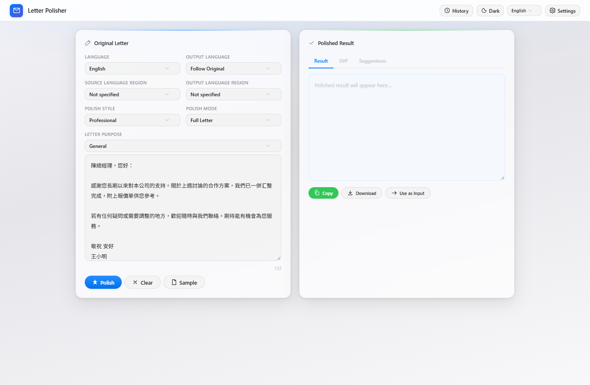
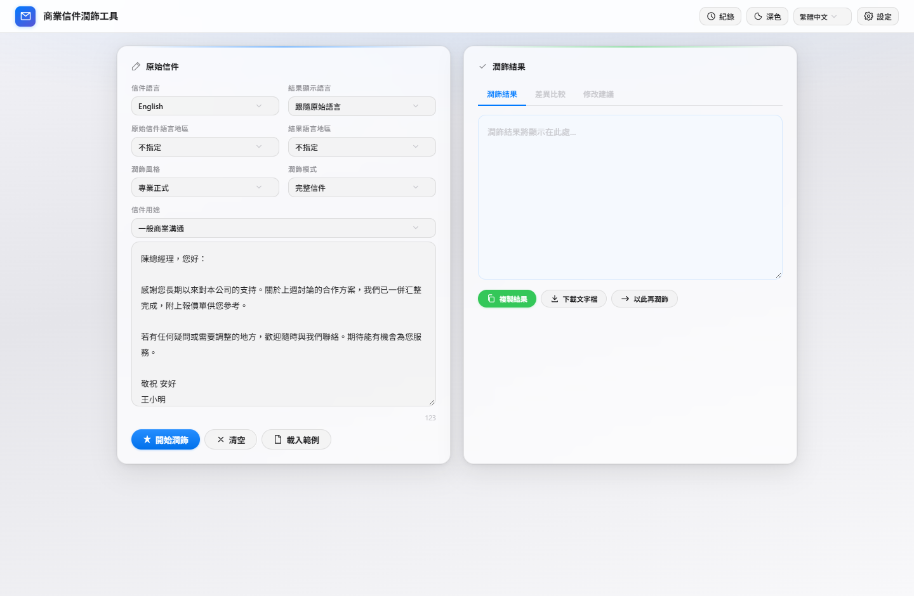
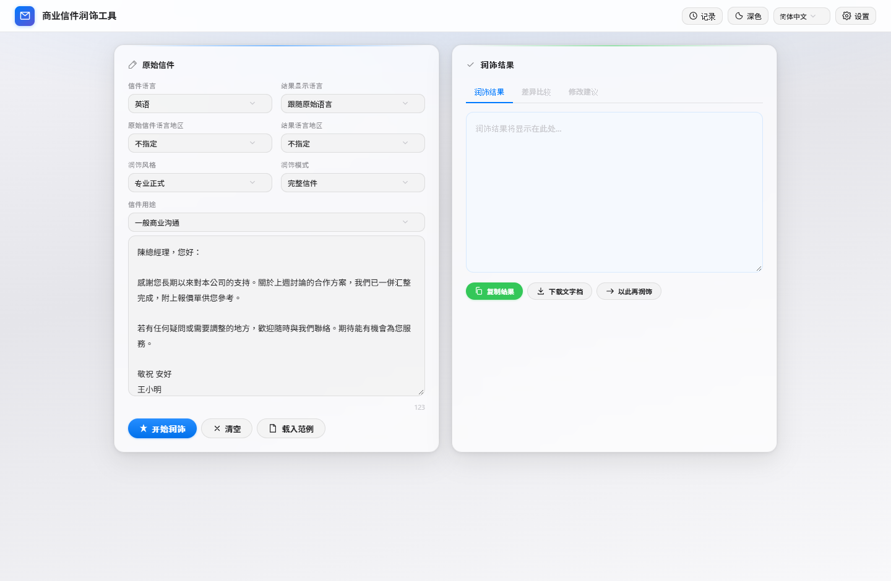

# Business Letter Polisher

A personal-use business letter polishing tool that works with any AI provider API.



**Language：** [繁體中文](README.md) ｜ [简体中文](README.zh-CN.md) ｜ English

## Quick Start

Just run `商业信件润饰工具.exe`. A setup wizard appears automatically on first launch.

## Features

- **AI provider mode** — Save multiple providers (name, URL, API key, format, model) and switch between them from a dropdown
- **Model list loading** — Enter the AI URL and key, then fetch the available models in one click and pick from the list
- **API formats** — OpenAI-compatible / Anthropic / Gemini
- **Glassmorphism UI** — Frosted-glass look with light and dark themes
- **Multilingual interface** — Traditional Chinese, Simplified Chinese and English; switching a language updates the entire UI, including the toolbar and every dropdown
- **Separate letter and result languages** — Choose the source letter's language and the language the polished result should be presented in, independently
- **Language regions** — Pick a region for the source language and another for the result language, so the AI knows which region's spelling, wording and business conventions to follow
- **Tone and purpose** — Built-in tone presets and letter purposes, plus free-form custom tone and custom purpose
- **Polish modes** — Polish the full letter or only its content
- **Diff comparison** — Original vs. polished text side by side
- **Revision notes** — AI explanations of the changes, written in the letter's language
- **Clean output** — The result contains only the polished text, with no AI preamble, tutorial or reminders
- **Load sample** — Insert a demo letter in one click
- **Copy and download** — Copy the result or download it as a text file
- **Polish again** — Feed the result back in as a new input
- **History** — History button in the toolbar plus a side panel
- **Quick setup** — Save the current options as your preferences, or restore the defaults
- **Persistent settings** — Stored in localStorage and kept across restarts
- **Online updates** — Check, download and install new versions from the settings panel, with download progress
- **Auto window sizing** — The window adapts to the available screen area

## Interface Preview

| 繁體中文 | 简体中文 | English |
|---|---|---|
|  |  |  |

## File Structure

The source project and the release package are laid out differently; both are shown below.

### Release package (after extraction)

```
BusinessLetterPolisher/
├── 商业信件润饰工具.exe         Main executable
├── 商业信件润饰工具.exe.config .NET configuration
├── SetupWizard.exe              Installer wizard (GUI)
├── letter-polisher.html         Interface (HTML + CSS + JS)
├── icon.ico                     Application icon
├── version.json                 Version info (used by online update)
├── README.md                    This document (Traditional Chinese)
├── README.zh-CN.md              Simplified Chinese documentation
├── README.en.md                 English documentation (this file)
├── setup.bat / setup.ps1        Scripted install without the wizard
├── WebView2Loader.dll           WebView2 loader
├── Microsoft.Web.WebView2.Core.dll
├── Microsoft.Web.WebView2.WinForms.dll
├── runtime/                     WebView2 Chromium Runtime (full package only, ~250MB)
└── user_data/                   User data (created automatically)
```

### Source project

```
BusinessLetterPolisher/
├── App.cs                       Main source (WebView2 window, online update)
├── SetupWizard.cs               Installer wizard source
├── letter-polisher.html         Interface (single HTML + CSS + JS file)
├── version.json                 Version info
├── build-package.ps1            Development packaging script
├── release-package.ps1          Release packaging script (lite + full)
├── Screenshot/                  Interface screenshots (one per language)
└── runtime/                     WebView2 Chromium Runtime
```

## Usage

1. Click the gear icon on the right of the toolbar to open settings
2. Choose an existing provider from the **AI Provider** dropdown, or press **Add Provider** to create one (you can name it yourself)
3. Enter that provider's AI URL and API key, press **Load Models** to fetch the available models and pick one (or type it manually)
4. Press **Test Connection**, then **Save**
5. Enter the letter in the left pane, then pick the letter language and region, the result language and region, the tone and the purpose
6. Press **Polish**

### Letter language vs. result language

- **Letter language** — the language the source letter is written in
- **Result display language** — the language the polished result should be presented in
- **Source letter region** — tells the AI which region's language conventions the source letter follows
- **Result language region** — tells the AI which region's language conventions the result should follow

Revision notes are always written in the letter's language, never in the result display language.

## Keyboard Shortcuts

- `Ctrl+Enter` — polish directly from the input box
- `Esc` — close the current panel or dialog

## Requirements

- Windows 10/11 (64-bit)
- The lite package requires the WebView2 Runtime to be installed; the full package bundles it and needs nothing else

## Using It on Another Computer

### Option 1: Run the installer wizard (recommended)

1. Copy the whole `商业信件润饰工具` folder to the target computer (or extract the ZIP)
2. Double-click `SetupWizard.exe`
3. Follow the wizard:
   - Choose the install path (defaults to `%LocalAppData%\BusinessLetterPolisher`)
   - WebView2 Runtime is detected automatically
   - A desktop shortcut is created automatically
4. You can launch the app immediately when installation finishes

### Option 2: Run the executable directly

1. Copy the folder to the target computer
2. Run `商业信件润饰工具.exe`
3. The guided setup appears on first use

### Option 3: Package a ZIP for distribution

Run the packaging script:

```powershell
powershell -ExecutionPolicy Bypass -File release-package.ps1
```

This produces two packages in `dist/`:

| File | Contents | Purpose |
|------|----------|---------|
| `BusinessLetterPolisher.zip` | Lite package, no runtime | Online update (`latest/download/`) |
| `BusinessLetterPolisher-full-<version>.zip` | Full package, includes runtime | Offline distribution, machines without WebView2 |

### SetupWizard.exe options

| Option | Description |
|--------|-------------|
| Custom install path | Defaults to `%LocalAppData%\BusinessLetterPolisher`, freely changeable |
| WebView2 Runtime | Detected automatically; copied when present, otherwise the system-installed one is used |
| Desktop shortcut | Optional, enabled by default |
| Launch after install | Optional, enabled by default |
| Progress display | Live progress and current file |

**Important when overwriting an install**: do not overwrite the `user_data/` or `runtime/` folders when updating. The first holds the user's settings and history; the second is the WebView2 runtime.

---

## Online Update Mechanism

The tool can check for new versions online and download and install them. The setup and deployment steps follow.

### Architecture

```
┌─────────────┐     fetch(version.json)     ┌──────────────────┐
│ User's PC   │ ──────────────────────────► │  GitHub / site    │
│  (App)      │ ◄────────────────────────── │  (version.json)   │
│             │     compare version         │                   │
└─────────────┘                              └──────────────────┘
       │
       │ when a newer version exists
       ▼
  confirm → download ZIP → show progress → extract → install → restart
```

### How it works

The app never updates itself on startup. When the user presses **Check for Updates** in the settings panel:

1. The app downloads `version.json` from the remote URL
2. It compares the remote version with the local version (semantic versioning)
3. If a newer version exists, a confirmation dialog appears
4. On confirmation the ZIP is downloaded and progress is shown
5. The updater takes over after extraction, replaces the files and restarts the app

### Deployment

#### 1. Create a GitHub repository

Create a public GitHub repository, for example:
`https://github.com/2mf-hermes/BusinessLetterPolisher`

#### 2. Upload the release

After running the packaging script, upload the ZIP files to GitHub Releases:

```bash
git tag v2026.10.01.14
git push origin v2026.10.01.14
```

Create the Release on GitHub with only the version number as its title and only categorised bullet lists (Added / Fixed / Improved / Removed) in the description. Attach these assets:

- `BusinessLetterPolisher.zip` (lite package; the online update pulls this one)
- `BusinessLetterPolisher-full-<version>.zip` (full package)

#### 3. Upload version.json

Place `version.json` on the repository's main branch, or host it at any publicly reachable URL:

```json
{
  "version": "2026.10.01.14",
  "release_date": "2026-10-01",
  "min_app_version": "2026.08.27",
  "download_url": "https://github.com/2mf-hermes/BusinessLetterPolisher/releases/latest/download/BusinessLetterPolisher.zip",
  "release_notes_url": "https://github.com/2mf-hermes/BusinessLetterPolisher/releases/latest",
  "release_notes": {
    "zh-TW": "## 修復\n\n- 工具列按鈕語言切換\n- 信件語言與結果語言清單語言切換",
    "zh-CN": "## 修复\n\n- 工具栏按钮语言切换\n- 信件语言与结果语言列表语言切换",
    "en": "## Fixed\n\n- Toolbar button language switching\n- Letter/result language list language switching"
  }
}
```

#### 4. Change UPDATE_URL in the app

In `letter-polisher.html`, find:

```javascript
var UPDATE_URL='https://raw.githubusercontent.com/2mf-hermes/BusinessLetterPolisher/main/version.json';
```

and change it to the real URL of your `version.json`.

#### 5. Rebuild the EXE

```powershell
C:\Windows\Microsoft.NET\Framework64\v4.0.30319\csc.exe /target:winexe /win32icon:icon.ico /out:商业信件润饰工具.exe /reference:Microsoft.Web.WebView2.Core.dll /reference:Microsoft.Web.WebView2.WinForms.dll /reference:System.IO.Compression.dll /reference:System.IO.Compression.FileSystem.dll App.cs
```

### Version numbering

Version numbers use `YYYY.MM.DD` (for example `2026.10.01`). A second release on the same day appends a sequence number (for example `2026.10.01.14`).

For every release:

1. Update `version` in `version.json`
2. Update the `APP_VERSION` variable in `letter-polisher.html`
3. Update `release_notes` in `version.json` (all languages)

### version.json fields

| Field | Type | Description |
|-------|------|-------------|
| `version` | string | Version number (YYYY.MM.DD) |
| `release_date` | string | Release date |
| `min_app_version` | string | Minimum compatible version |
| `download_url` | string | ZIP download URL |
| `release_notes_url` | string | Release page URL |
| `release_notes` | object | Localised notes (zh-TW / zh-CN / en) |

### Alternatives

GitHub is not required. You can also use:

- **Any HTTP server** — host `version.json` on a website
- **Google Drive** — share publicly and use the direct download link
- **Your own server** — upload to any HTTPS site

The key requirement is that `version.json` must be reachable over **HTTPS** (a WebView2 fetch restriction).

### Security notes

- The version check runs only when the user triggers it manually
- Nothing is downloaded or installed without confirmation
- Updates come from the official GitHub Releases URL
- Settings such as API keys stay in localStorage and are never sent during an update

---

## Building from Source

Requires .NET Framework 4.x (included with Windows):

### Main application

```powershell
C:\Windows\Microsoft.NET\Framework64\v4.0.30319\csc.exe /target:winexe /win32icon:icon.ico /out:商业信件润饰工具.exe /reference:Microsoft.Web.WebView2.Core.dll /reference:Microsoft.Web.WebView2.WinForms.dll /reference:System.IO.Compression.dll /reference:System.IO.Compression.FileSystem.dll App.cs
```

> Any change to `App.cs` (the update flow or download progress reporting, for example) **must** be followed by this compile command before releasing. Otherwise the packaged EXE is still the old build and online updates break. HTML/JS-only changes do not require rebuilding the EXE.

### Installer wizard

```powershell
C:\Windows\Microsoft.NET\Framework\v4.0.30319\csc.exe /target:winexe /out:SetupWizard.exe /r:System.Windows.Forms.dll /r:System.Drawing.dll SetupWizard.cs
```

The WebView2 NuGet package is available at https://www.nuget.org/packages/Microsoft.Web.WebView2.

## License

This project is a personal-use tool. Check the terms of service of the AI service you use.
