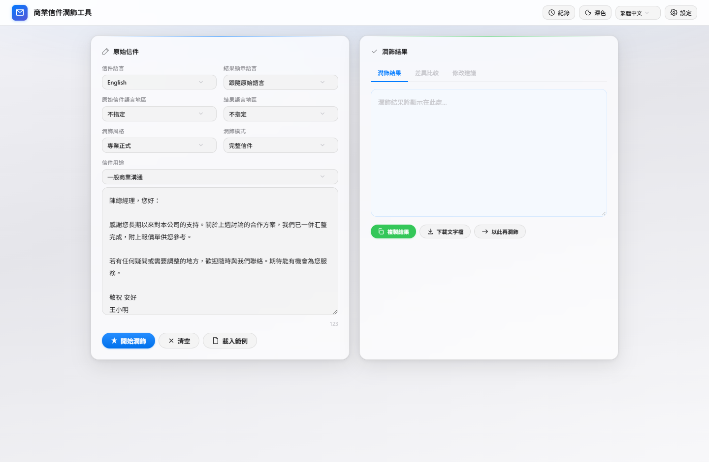
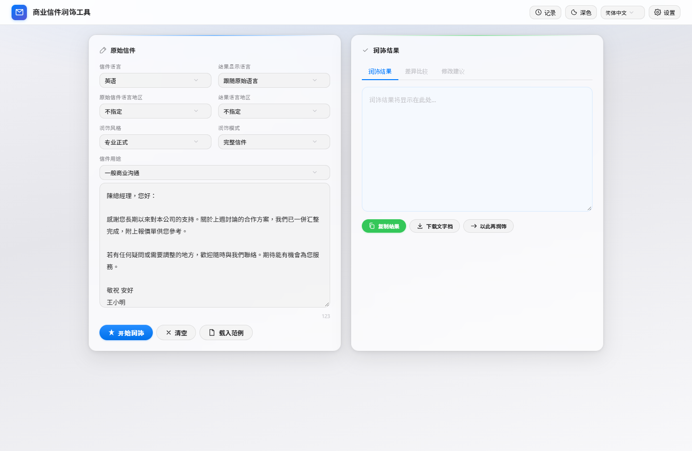
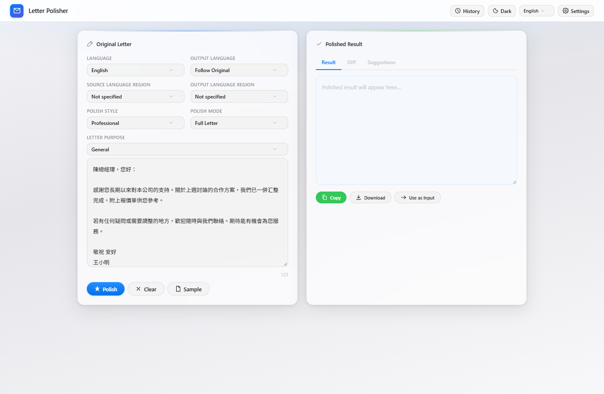

# 商業信件潤飾工具 / Business Letter Polisher

支援各家 AI API 的個人版商業信件潤飾工具。



**語言 / Language：** 繁體中文 ｜ [简体中文](README.zh-CN.md) ｜ [English](README.en.md)

## 快速開始

直接執行 `商業信件潤飾工具.exe` 即可使用。首次執行會自動顯示引導精靈。

## 功能特色

- **AI 供應商模式** — 儲存多組供應商（名稱、URL、API Key、格式、模型）並用下拉清單快速切換
- **模型清單載入** — 填入 AI URL 與 Key 後一鍵查詢可用模型，直接從清單挑選
- **API 格式** — OpenAI 相容 / Anthropic / Gemini
- **玻璃質感介面** — 毛玻璃視覺，亮色 / 暗色模式切換
- **多語言介面** — 繁體中文、简体中文、English，切換後全介面（含工具列、下拉選單）同步顯示該語言
- **信件語言與結果語言分離** — 分別指定原始信件語言與潤飾結果要呈現的語言
- **語言地區指定** — 可分別選擇原始信件語言地區與結果語言地區，告訴 AI 該用哪種地區的用字、拼寫與商業書寫慣例
- **潤飾風格與用途** — 內建多種風格與信件用途，可自由描述自訂風格與自訂用途
- **潤飾模式** — 完整信件或僅潤飾內容
- **差異比較** — 原文 vs 潤飾結果並列比對
- **修改建議** — AI 另附修改說明，使用信件語言回答
- **純粹結果輸出** — 潤飾結果只保留結果本身，不含 AI 前言、教學或提醒
- **載入範例** — 一鍵載入示範信件
- **複製與下載** — 一鍵複製結果或下載文字檔
- **以此再潤飾** — 以結果為輸入再次潤飾
- **歷史紀錄** — 工具列紀錄按鈕 + 側邊面板
- **快速設定** — 可將目前選項存為偏好，或還原預設選項
- **設定持久化** — 存於 localStorage，重開不失效
- **線上更新** — 設定面板可檢查更新、下載並安裝新版本，顯示下載進度
- **視窗自動調整** — 依螢幕可用範圍自動調整視窗大小

## 介面預覽

| 繁體中文 | 简体中文 | English |
|---|---|---|
|  |  |  |

## 檔案結構

程式專案與發行包結構不同，分列如下。

### 發行包（解壓縮後）

```
商業信件潤飾工具/
├── 商業信件潤飾工具.exe         主程式
├── 商業信件潤飾工具.exe.config  .NET 設定檔
├── SetupWizard.exe              安裝精靈（圖形化介面）
├── letter-polisher.html         介面（HTML+CSS+JS）
├── icon.ico                     應用程式圖示
├── version.json                 版本資訊（線上更新用）
├── README.md                    本說明文件（三語）
├── README.zh-CN.md              簡體中文說明
├── README.en.md                 英文說明
├── setup.bat / setup.ps1        免精靈的安裝腳本
├── WebView2Loader.dll           WebView2 載入器
├── Microsoft.Web.WebView2.Core.dll
├── Microsoft.Web.WebView2.WinForms.dll
├── runtime/                     WebView2 Chromium Runtime（完整版才有，約 250MB）
└── user_data/                   使用者資料（自動建立）
```

### 原始碼專案

```
BusinessLetterPolisher/
├── App.cs                       主程式原始碼（WebView2 視窗、線上更新）
├── SetupWizard.cs               安裝精靈原始碼
├── letter-polisher.html         介面（HTML+CSS+JS 單檔）
├── version.json                 版本資訊
├── build-package.ps1            開發用打包腳本
├── release-package.ps1          發行用打包腳本（精簡版 + 完整版）
├── Screenshot/                  介面截圖（依語言分檔）
└── runtime/                     WebView2 Chromium Runtime
```

## 使用說明

1. 點擊工具列右側齒輪開啟設定
2. 在「AI 供應商」下拉清單選擇既有供應商，或按「新增供應商」建立一組（可自行命名）
3. 輸入該供應商的 AI URL 與 API Key，按「載入模型」查詢可用模型並從清單挑選（也可手動輸入）
4. 按「測試連線」確認可用後「儲存」
5. 在左側輸入信件，選擇信件語言／地區、結果語言／地區、潤飾風格與信件用途
6. 按「開始潤飾」

### 信件語言與結果語言

- **信件語言** — 目前原始信件輸入的語言
- **結果顯示語言** — 潤飾結果要呈現的語言
- **原始信件語言地區** — 告訴 AI 原始信件屬於哪個地區的語言習慣
- **結果語言地區** — 告訴 AI 潤飾結果要呈現哪個地區的語言習慣

「修改建議」一律使用信件語言回答，不使用結果顯示語言。

## 快捷鍵

- `Ctrl+Enter` — 在輸入框中直接潤飾
- `Esc` — 關閉面板 / 彈窗

## 系統需求

- Windows 10/11（64-bit）
- 精簡版需系統已安裝 WebView2 Runtime；完整版自帶 runtime，無需安裝任何軟體

## 在其他電腦上使用

### 方式一：執行安裝精靈（推薦）

1. 將整個 `商業信件潤飾工具` 資料夾複製到目標電腦（或解壓縮 ZIP）
2. 雙擊執行 `SetupWizard.exe`
3. 按照精靈指示完成安裝：
   - 選擇安裝路徑（預設 `%LocalAppData%\BusinessLetterPolisher`）
   - 自動偵測 WebView2 Runtime
   - 自動建立桌面捷徑
4. 安裝完成後可選擇立即啟動

### 方式二：直接執行主程式

1. 將資料夾複製到目標電腦
2. 直接執行 `商業信件潤飾工具.exe`
3. 首次使用會自動顯示引導設定

### 方式三：打包成 ZIP 分發

執行打包腳本：

```powershell
powershell -ExecutionPolicy Bypass -File release-package.ps1
```

會在 `dist/` 產生兩種發行包：

| 檔案 | 內容 | 用途 |
|------|------|------|
| `BusinessLetterPolisher.zip` | 精簡版，不含 runtime | 線上更新用（`latest/download/`） |
| `BusinessLetterPolisher-full-<version>.zip` | 完整版，含 runtime | 離線分發、無 WebView2 環境 |

### SetupWizard.exe 安裝精靈功能

| 功能 | 說明 |
|------|------|
| 自訂安裝路徑 | 預設安裝到 `%LocalAppData%\BusinessLetterPolisher`，可自選 |
| WebView2 Runtime | 自動偵測，有則複製，無則使用系統已安裝版本 |
| 桌面捷徑 | 選項，預設開啟 |
| 安裝後啟動 | 選項，預設開啟 |
| 進度顯示 | 即時顯示複製進度與目前檔案 |

**覆蓋安裝注意**：更新或覆蓋程式時，請勿覆蓋 `user_data/` 與 `runtime/` 資料夾，前者保存使用者設定與歷史紀錄，後者是 WebView2 執行環境。

---

## 線上更新機制

本工具支援線上檢查新版本與線上下載安裝。以下是設定與部署方法。

### 架構說明

```
┌─────────────┐     fetch(version.json)     ┌──────────────────┐
│ 使用者電腦   │ ──────────────────────────► │  GitHub / 網站     │
│  (App)      │ ◄────────────────────────── │  (version.json)   │
│             │     比較版本號               │                   │
└─────────────┘                              └──────────────────┘
       │
       │ 版本較新時
       ▼
  確認 → 下載 ZIP → 顯示下載進度 → 解壓縮 → 安裝 → 重啟
```

### 原理

App 啟動時不會自動更新。使用者在設定面板點擊「檢查更新」按鈕時：

1. App 從遠端下載 `version.json`
2. 比較遠端版本號與本地版本號（語意化版本）
3. 若有新版本，跳出確認對話框
4. 使用者確認後下載 ZIP 並顯示下載進度
5. 解壓縮後由 updater 接手，替換檔案並重啟程式

### 部署步驟

#### 1. 建立 GitHub Repository

建立一個公開的 GitHub Repository，例如：
`https://github.com/2mf-hermes/BusinessLetterPolisher`

#### 2. 上傳發行版

執行打包腳本後，將 ZIP 檔案上傳到 GitHub Releases：

```bash
git tag v2026.10.01.14
git push origin v2026.10.01.14
```

在 GitHub 上建立 Release，標題只留版本號，說明只寫「新增 / 修復 / 改善 / 刪除」分類條列。上傳下列 Asset：

- `BusinessLetterPolisher.zip`（精簡版，線上更新抓這個）
- `BusinessLetterPolisher-full-<version>.zip`（完整版）

#### 3. 上傳 version.json

將 `version.json` 放到 Repository 的 main 分支，或放在任何可公開存取的 URL：

```json
{
  "version": "2026.10.01.14",
  "release_date": "2026-10-01",
  "min_app_version": "2026.08.27",
  "download_url": "https://github.com/2mf-hermes/BusinessLetterPolisher/releases/latest/download/BusinessLetterPolisher.zip",
  "release_notes_url": "https://github.com/2mf-hermes/BusinessLetterPolisher/releases/latest",
  "release_notes": {
    "zh-TW": "## 修復\n\n- 工具列按鈕語言切換\n- 信件語言與結果語言清單語言切換",
    "zh-CN": "## 修复\n\n- 工具栏按钮语言切换\n- 信件语言与结果语言列表语言切换",
    "en": "## Fixed\n\n- Toolbar button language switching\n- Letter/result language list language switching"
  }
}
```

#### 4. 修改 App 的 UPDATE_URL

在 `letter-polisher.html` 中找到：

```javascript
var UPDATE_URL='https://raw.githubusercontent.com/2mf-hermes/BusinessLetterPolisher/main/version.json';
```

將其改為你的 `version.json` 實際 URL。

#### 5. 重新編譯 EXE

```powershell
C:\Windows\Microsoft.NET\Framework64\v4.0.30319\csc.exe /target:winexe /win32icon:icon.ico /out:商業信件潤飾工具.exe /reference:Microsoft.Web.WebView2.Core.dll /reference:Microsoft.Web.WebView2.WinForms.dll /reference:System.IO.Compression.dll /reference:System.IO.Compression.FileSystem.dll App.cs
```

### 版本號格式

版本號格式為 `YYYY.MM.DD`（例如 `2026.10.01`）。同日再次發行時追加序號（例如 `2026.10.01.14`）。

每次發版時：

1. 更新 `version.json` 中的 `version` 欄位
2. 更新 `letter-polisher.html` 中的 `APP_VERSION` 變數
3. 更新 `version.json` 中的 `release_notes`（多語言）

### version.json 欄位說明

| 欄位 | 類型 | 說明 |
|------|------|------|
| `version` | string | 版本號（YYYY.MM.DD） |
| `release_date` | string | 發行日期 |
| `min_app_version` | string | 最低相容版本 |
| `download_url` | string | ZIP 下載網址 |
| `release_notes_url` | string | Release 頁面網址 |
| `release_notes` | object | 多語言更新說明（zh-TW / zh-CN / en） |

### 替代方案

如果不想用 GitHub，也可以使用：

- **任何 HTTP 伺服器**：將 `version.json` 放到網站上
- **Google Drive**：設定為公開分享，使用直接下載連結
- **自己的伺服器**：上傳到任意 HTTPS 站點

關鍵要求：`version.json` 必須可以透過 **HTTPS** 存取（WebView2 的 fetch 限制）。

### 安全注意事項

- 版本比較只在使用者手動觸發時執行
- 不會在未確認的情況下自動下載或安裝任何檔案
- 更新下載來自 GitHub Releases 的官方網址
- API Key 等設定存在本地 localStorage，不會隨更新傳送

---

## 從原始碼編譯

需要 .NET Framework 4.x（Windows 內建）：

### 主程式

```powershell
C:\Windows\Microsoft.NET\Framework64\v4.0.30319\csc.exe /target:winexe /win32icon:icon.ico /out:商業信件潤飾工具.exe /reference:Microsoft.Web.WebView2.Core.dll /reference:Microsoft.Web.WebView2.WinForms.dll /reference:System.IO.Compression.dll /reference:System.IO.Compression.FileSystem.dll App.cs
```

> 只要改過 `App.cs`（例如線上更新流程、下載進度回報），發行前**務必重新執行這個編譯指令**，否則打包出去的 exe 仍是舊的，線上更新會失效。純 HTML／JS 修改則不需重編 exe。

### 安裝精靈

```powershell
C:\Windows\Microsoft.NET\Framework\v4.0.30319\csc.exe /target:winexe /out:SetupWizard.exe /r:System.Windows.Forms.dll /r:System.Drawing.dll SetupWizard.cs
```

WebView2 NuGet 套件可從 https://www.nuget.org/packages/Microsoft.Web.WebView2 下載。

## 授權

本專案為個人使用工具，請自行確認所用 AI 服務的使用條款。
