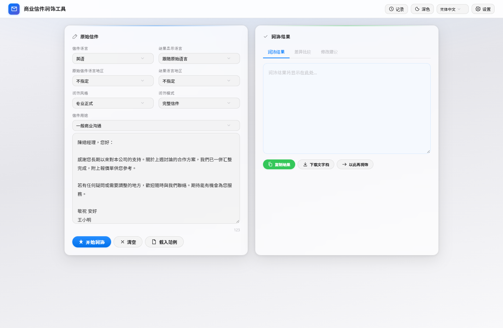
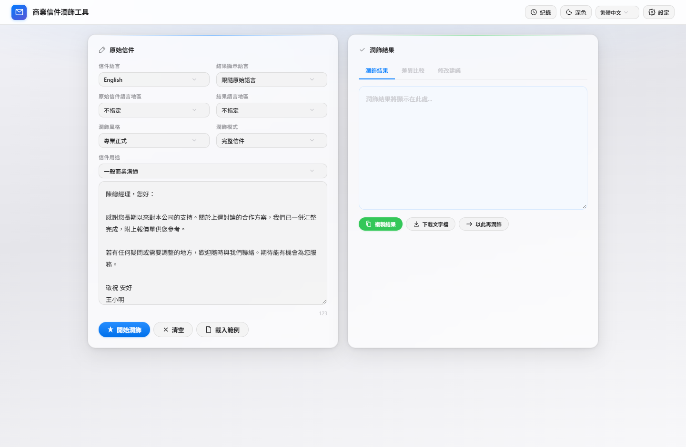
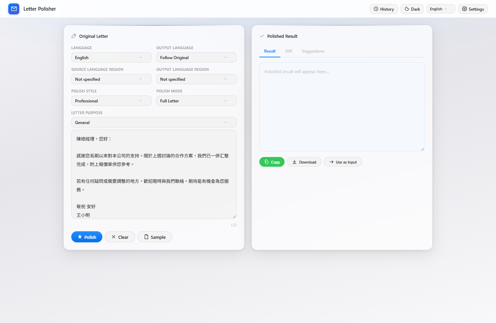

# 商业信件润饰工具 / Business Letter Polisher

支持各家 AI API 的个人版商业信件润饰工具。



**语言 / Language：** [繁體中文](README.md) ｜ 简体中文 ｜ [English](README.en.md)

## 快速开始

直接运行 `商业信件润饰工具.exe` 即可使用。首次运行会自动显示引导向导。

## 功能特色

- **AI 供应商模式** — 储存多组供应商（名称、URL、API Key、格式、模型）并用下拉列表快速切换
- **模型列表加载** — 填入 AI URL 与 Key 后一键查询可用模型，直接从列表挑选
- **API 格式** — OpenAI 兼容 / Anthropic / Gemini
- **玻璃质感界面** — 毛玻璃视觉，亮色 / 暗色模式切换
- **多语言界面** — 繁體中文、简体中文、English，切换后全界面（含工具栏、下拉列表）同步显示该语言
- **信件语言与结果语言分离** — 分别指定原始信件语言与润饰结果要呈现的语言
- **语言地区指定** — 可分别选择原始信件语言地区与结果语言地区，告诉 AI 该用哪种地区的用字、拼写与商业书写惯例
- **润饰风格与用途** — 内建多种风格与信件用途，可自由描述自定义风格与自定义用途
- **润饰模式** — 完整信件或仅润饰内容
- **差异比较** — 原文 vs 润饰结果并列比对
- **修改建议** — AI 另附修改说明，使用信件语言回答
- **纯粹结果输出** — 润饰结果只保留结果本身，不含 AI 前言、教学或提醒
- **加载范例** — 一键加载示范信件
- **复制与下载** — 一键复制结果或下载文字文件
- **以此再润饰** — 以结果为输入再次润饰
- **历史记录** — 工具栏记录按钮 + 侧边面板
- **快速设置** — 可将目前选项存为偏好，或还原默认选项
- **设置持久化** — 存于 localStorage，重开不失效
- **在线更新** — 设置面板可检查更新、下载并安装新版本，显示下载进度
- **窗口自动调整** — 依屏幕可用范围自动调整窗口大小

## 界面预览

| 繁體中文 | 简体中文 | English |
|---|---|---|
|  |  |  |

## 文件结构

程序项目与发行包结构不同，分列如下。

### 发行包（解压缩后）

```
商业信件润饰工具/
├── 商业信件润饰工具.exe         主程序
├── 商业信件润饰工具.exe.config  .NET 设置文件
├── SetupWizard.exe              安装向导（图形化界面）
├── letter-polisher.html         界面（HTML+CSS+JS）
├── icon.ico                     应用程序图标
├── version.json                 版本资讯（在线更新用）
├── README.md                    本说明文件（三语）
├── README.zh-CN.md              简体中文说明
├── README.en.md                 英文说明
├── setup.bat / setup.ps1        免向导的安装脚本
├── WebView2Loader.dll           WebView2 加载器
├── Microsoft.Web.WebView2.Core.dll
├── Microsoft.Web.WebView2.WinForms.dll
├── runtime/                     WebView2 Chromium Runtime（完整版才有，约 250MB）
└── user_data/                   用户资料（自动建立）
```

### 原始码项目

```
BusinessLetterPolisher/
├── App.cs                       主程序原始码（WebView2 窗口、在线更新）
├── SetupWizard.cs               安装向导原始码
├── letter-polisher.html         界面（HTML+CSS+JS 单文件）
├── version.json                 版本资讯
├── build-package.ps1            开发用打包脚本
├── release-package.ps1          发行用打包脚本（精简版 + 完整版）
├── Screenshot/                  界面截图（依语言分档）
└── runtime/                     WebView2 Chromium Runtime
```

## 使用说明

1. 点击工具栏右侧齿轮开启设置
2. 在「AI 供应商」下拉列表选择既有供应商，或按「新增供应商」建立一组（可自行命名）
3. 输入该供应商的 AI URL 与 API Key，按「加载模型」查询可用模型并从列表挑选（也可手动输入）
4. 按「测试连线」确认可用后「储存」
5. 在左侧输入信件，选择信件语言／地区、结果语言／地区、润饰风格与信件用途
6. 按「开始润饰」

### 信件语言与结果语言

- **信件语言** — 目前原始信件输入的语言
- **结果显示语言** — 润饰结果要呈现的语言
- **原始信件语言地区** — 告诉 AI 原始信件属于哪个地区的语言习惯
- **结果语言地区** — 告诉 AI 润饰结果要呈现哪个地区的语言习惯

「修改建议」一律使用信件语言回答，不使用结果显示语言。

## 快捷键

- `Ctrl+Enter` — 在输入框中直接润饰
- `Esc` — 关闭面板 / 弹窗

## 系统需求

- Windows 10/11（64-bit）
- 精简版需系统已安装 WebView2 Runtime；完整版自带 runtime，无需安装任何软件

## 在其他电脑上使用

### 方式一：运行安装向导（推荐）

1. 将整个 `商业信件润饰工具` 文件夹复制到目标电脑（或解压缩 ZIP）
2. 双击运行 `SetupWizard.exe`
3. 按照向导指示完成安装：
   - 选择安装路径（预设 `%LocalAppData%\BusinessLetterPolisher`）
   - 自动侦测 WebView2 Runtime
   - 自动建立桌面快捷方式
4. 安装完成后可选择立即启动

### 方式二：直接运行主程序

1. 将文件夹复制到目标电脑
2. 直接运行 `商业信件润饰工具.exe`
3. 首次使用会自动显示引导设置

### 方式三：打包成 ZIP 分发

运行打包脚本：

```powershell
powershell -ExecutionPolicy Bypass -File release-package.ps1
```

会在 `dist/` 产生两种发行包：

| 文件 | 内容 | 用途 |
|------|------|------|
| `BusinessLetterPolisher.zip` | 精简版，不含 runtime | 在线更新用（`latest/download/`） |
| `BusinessLetterPolisher-full-<version>.zip` | 完整版，含 runtime | 离线分发、无 WebView2 环境 |

### SetupWizard.exe 安装向导功能

| 功能 | 说明 |
|------|------|
| 自定义安装路径 | 预设安装到 `%LocalAppData%\BusinessLetterPolisher`，可自选 |
| WebView2 Runtime | 自动侦测，有则复制，无则使用系统已安装版本 |
| 桌面快捷方式 | 选项，预设开启 |
| 安装后启动 | 选项，预设开启 |
| 进度显示 | 即时显示复制进度与目前文件 |

**覆盖安装注意**：更新或覆盖程序时，请勿覆盖 `user_data/` 与 `runtime/` 文件夹，前者保存用户设置与历史记录，后者是 WebView2 执行环境。

---

## 在线更新机制

本工具支持在线检查新版本与在线下载安装。以下是设置与部署方法。

### 架构说明

```
┌─────────────┐     fetch(version.json)     ┌──────────────────┐
│ 用户电脑     │ ──────────────────────────► │  GitHub / 网站     │
│  (App)      │ ◄────────────────────────── │  (version.json)   │
│             │     比较版本号               │                   │
└─────────────┘                              └──────────────────┘
       │
       │ 版本较新时
       ▼
  确认 → 下载 ZIP → 显示下载进度 → 解压缩 → 安装 → 重启
```

### 原理

App 启动时不会自动更新。用户在设置面板点击「检查更新」按钮时：

1. App 从远端下载 `version.json`
2. 比较远端版本号与本地版本号（语义化版本）
3. 若有新版本，跳出确认对话框
4. 用户确认后下载 ZIP 并显示下载进度
5. 解压缩后由 updater 接手，替换文件并重启程序

### 部署步骤

#### 1. 建立 GitHub Repository

建立一个公开的 GitHub Repository，例如：
`https://github.com/2mf-hermes/BusinessLetterPolisher`

#### 2. 上传发行版

运行打包脚本后，将 ZIP 文件上传到 GitHub Releases：

```bash
git tag v2026.10.01.14
git push origin v2026.10.01.14
```

在 GitHub 上建立 Release，标题只留版本号，说明只写「新增 / 修复 / 改善 / 删除」分类条列。上传下列 Asset：

- `BusinessLetterPolisher.zip`（精简版，在线更新抓这个）
- `BusinessLetterPolisher-full-<version>.zip`（完整版）

#### 3. 上传 version.json

将 `version.json` 放到 Repository 的 main 分支，或放在任何可公开存取的 URL：

```json
{
  "version": "2026.10.01.14",
  "release_date": "2026-10-01",
  "min_app_version": "2026.08.27",
  "download_url": "https://github.com/2mf-hermes/BusinessLetterPolisher/releases/latest/download/BusinessLetterPolisher.zip",
  "release_notes_url": "https://github.com/2mf-hermes/BusinessLetterPolisher/releases/latest",
  "release_notes": {
    "zh-TW": "## 修復\n\n- 工具列按鈕語言切換\n- 信件語言與結果語言清單語言切換",
    "zh-CN": "## 修复\n\n- 工具栏按钮语言切换\n- 信件语言与结果语言列表语言切换",
    "en": "## Fixed\n\n- Toolbar button language switching\n- Letter/result language list language switching"
  }
}
```

#### 4. 修改 App 的 UPDATE_URL

在 `letter-polisher.html` 中找到：

```javascript
var UPDATE_URL='https://raw.githubusercontent.com/2mf-hermes/BusinessLetterPolisher/main/version.json';
```

将其改为你的 `version.json` 实际 URL。

#### 5. 重新编译 EXE

```powershell
C:\Windows\Microsoft.NET\Framework64\v4.0.30319\csc.exe /target:winexe /win32icon:icon.ico /out:商业信件润饰工具.exe /reference:Microsoft.Web.WebView2.Core.dll /reference:Microsoft.Web.WebView2.WinForms.dll /reference:System.IO.Compression.dll /reference:System.IO.Compression.FileSystem.dll App.cs
```

### 版本号格式

版本号格式为 `YYYY.MM.DD`（例如 `2026.10.01`）。同日再次发行时追加序号（例如 `2026.10.01.14`）。

每次发版时：

1. 更新 `version.json` 中的 `version` 字段
2. 更新 `letter-polisher.html` 中的 `APP_VERSION` 变量
3. 更新 `version.json` 中的 `release_notes`（多语言）

### version.json 字段说明

| 字段 | 类型 | 说明 |
|------|------|------|
| `version` | string | 版本号（YYYY.MM.DD） |
| `release_date` | string | 发行日期 |
| `min_app_version` | string | 最低兼容版本 |
| `download_url` | string | ZIP 下载网址 |
| `release_notes_url` | string | Release 页面网址 |
| `release_notes` | object | 多语言更新说明（zh-TW / zh-CN / en） |

### 替代方案

如果不想用 GitHub，也可以使用：

- **任何 HTTP 服务器**：将 `version.json` 放到网站上
- **Google Drive**：设置为公开分享，使用直接下载链接
- **自己的服务器**：上传到任意 HTTPS 站点

关键要求：`version.json` 必须可以透过 **HTTPS** 存取（WebView2 的 fetch 限制）。

### 安全注意事项

- 版本比较只在用户手动触发时执行
- 不会在未确认的情况下自动下载或安装任何文件
- 更新下载来自 GitHub Releases 的官方网址
- API Key 等设置存在本地 localStorage，不会随更新传送

---

## 从原始码编译

需要 .NET Framework 4.x（Windows 内建）：

### 主程序

```powershell
C:\Windows\Microsoft.NET\Framework64\v4.0.30319\csc.exe /target:winexe /win32icon:icon.ico /out:商业信件润饰工具.exe /reference:Microsoft.Web.WebView2.Core.dll /reference:Microsoft.Web.WebView2.WinForms.dll /reference:System.IO.Compression.dll /reference:System.IO.Compression.FileSystem.dll App.cs
```

> 只要改过 `App.cs`（例如在线更新流程、下载进度回报），发行前**务必重新运行这个编译指令**，否则打包出去的 exe 仍是旧的，在线更新会失效。纯 HTML／JS 修改则不需重编 exe。

### 安装向导

```powershell
C:\Windows\Microsoft.NET\Framework\v4.0.30319\csc.exe /target:winexe /out:SetupWizard.exe /r:System.Windows.Forms.dll /r:System.Drawing.dll SetupWizard.cs
```

WebView2 NuGet 套件可从 https://www.nuget.org/packages/Microsoft.Web.WebView2 下载。

## 授权

本专案为个人使用工具，请自行确认所用 AI 服务的服务条款。
